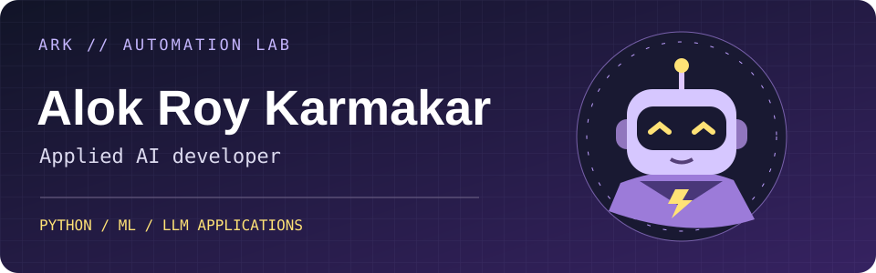

[Mission files](#mission-files) · [Evaluation lab](#evaluation-lab) · [Interactive portfolio](https://royalokkarmakar1994.github.io/portfolio/) · [LinkedIn](https://www.linkedin.com/in/alokroykarmakar1994)

I build Python tools for procurement and predictive maintenance. I like making each step inspectable, from the numbers used to rank a vendor to the errors a classifier makes on held-out data. I'm open to remote applied AI roles.

## Mission files

| Project | Input → output | Inside the project |
| :--- | :--- | :--- |
| [**Procurement AI Agent**](https://github.com/royalokkarmakar1994/procurement-ai-agent) | Vendor records → ranked shortlist | A [weighted scorer](https://github.com/royalokkarmakar1994/procurement-ai-agent/blob/main/scorer.py) ranks six criteria. Llama on Groq uses the scores to draft a recommendation. |
| [**ManufactureAI**](https://github.com/royalokkarmakar1994/manufacture-ai) | Simulated sensor readings → failure probability | A Random Forest estimates risk. The [dashboard](https://github.com/royalokkarmakar1994/manufacture-ai/blob/main/app.py) shows missed failures and false alarms, with optional Claude explanations. |
| [**RFP Analyzer**](https://github.com/royalokkarmakar1994/procurement-rfp-analyzer) | Vendor PDF → pricing table and SLA risks | A [Streamlit app](https://github.com/royalokkarmakar1994/procurement-rfp-analyzer/blob/main/app.py) passes extracted text to an OpenAI model through LangChain. |
| [**Customer Churn Prediction**](https://github.com/royalokkarmakar1994/customer-churn-prediction) | Telecom customer data → churn prediction | A [notebook](https://github.com/royalokkarmakar1994/customer-churn-prediction/blob/main/Customer_Churn_Project.ipynb) compares logistic regression and Random Forest. |

<!-- Add future projects as rows using the same three columns. -->

## Evaluation lab

My next focus is coding-agent evaluation. One question I'd like to investigate is whether an agent can fix a vendor-ranking bug while preserving the order of unaffected vendors. I'd score the patch against expected rankings, rerun it on unseen inputs, and inspect the cases where it fails.

## Toolbox

Explore languages in my public repositories

